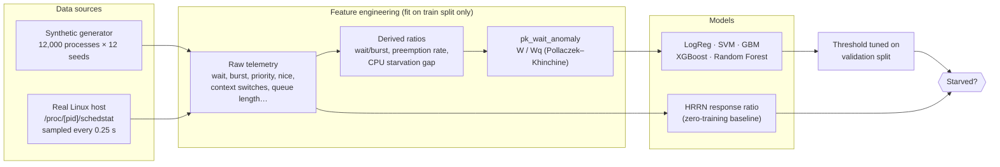
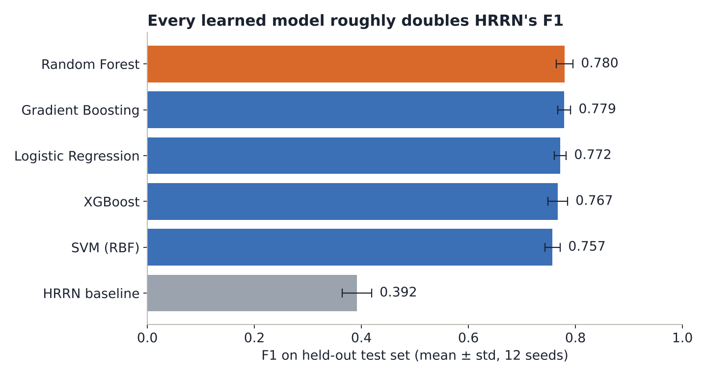
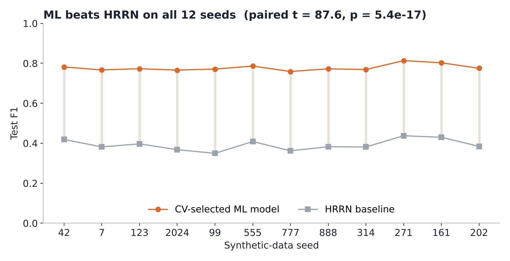
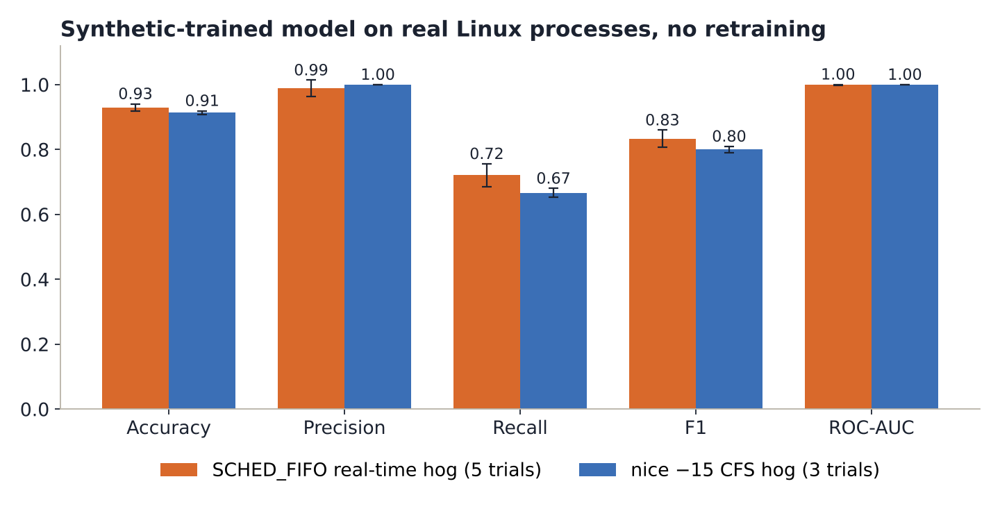
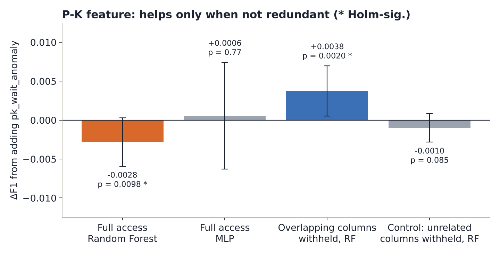

<div align="center">

# Process Starvation Detection with Machine Learning

**Detecting CPU starvation on a running Linux system from kernel scheduler telemetry,
using a queueing-theory-informed classifier benchmarked against HRRN and validated on real processes.**


</div>

---

## Overview

Operating systems usually deal with starvation **by construction**: aging, fair-share scheduling and policies like HRRN are designed so that no process waits forever. Those guarantees only hold under each scheduler's own assumptions. Real-time preemption, cgroup throttling, priority inversion and aggressive `nice` values can still leave a runnable process without CPU time.

This project takes the opposite, scheduler-agnostic view. It **observes a running system from the outside** and asks a binary question about each process:

> Given what the kernel reports right now, is this process being starved?

To answer it, the project:

1. reads per-process scheduling telemetry straight from `/proc/[pid]/schedstat`, `/proc/[pid]/stat` and `/proc/[pid]/status`;
2. adds **`pk_wait_anomaly`**, a feature derived from the **Pollaczek–Khinchine** formula for expected waiting time in an M/G/1 queue;
3. trains and compares five tabular classifiers;
4. benchmarks them against **HRRN's response ratio** used as a zero-training classifier;
5. applies the synthetic-trained model, **unchanged**, to real competing Linux processes under `SCHED_FIFO` and `nice` contention.

## Highlights

| | Result |
|---|---|
| **ML vs classical baseline** | CV-selected model F1 **0.778** vs HRRN **0.392** across 12 seeds (paired *t* = 87.6, *p* = 5.4 × 10⁻¹⁷) |
| **Best model (synthetic)** | Random Forest, F1 **0.780 ± 0.016**, ROC-AUC 0.965 |
| **Real hardware, `SCHED_FIFO` hog** | Precision **0.989**, Recall 0.721, F1 **0.833**, ROC-AUC 0.999 (5 trials) |
| **Real hardware, `nice −15` hog** | Precision **1.000**, Recall 0.667, F1 **0.800**, ROC-AUC 1.000 (3 trials) |
| **Queueing-theory feature** | Slightly *hurts* when overlapping raw columns are present (ΔF1 −0.0028), *helps* when they are withheld (ΔF1 +0.0038); both Holm–Bonferroni significant |

## Architecture



**Data split:** 60 / 20 / 20 train / validation / test. Model selection, hyperparameter search and the decision threshold all use the validation split, so the test set is touched exactly once.

## How it works

### 1. Kernel telemetry

`collect_real_data.py` launches real competing processes and samples the kernel's own scheduler accounting every 0.25 s, aggregating into 2-second windows:

| Source | What we read |
|---|---|
| `/proc/[pid]/schedstat` | time on CPU, time waiting on the run queue, number of timeslices |
| `/proc/[pid]/stat` | priority, nice, state |
| `/proc/[pid]/status` | voluntary / non-voluntary context switches, threads, RSS |

Run-queue wait is **measured directly** rather than estimated as wall-clock time minus CPU time.

### 2. The Pollaczek–Khinchine feature

For each process class, the expected queueing delay in an M/G/1 queue is

$$W_q = \frac{\lambda \, E[S^2]}{2(1-\rho)}$$

with the arrival rate λ backed out using Little's Law (L = λW), E[S²] the second moment of burst time and ρ the utilisation. The feature is

```
pk_wait_anomaly = W_observed / Wq
```

Values well above 1 flag a process waiting much longer than its class's load explains.

### 3. HRRN as a baseline classifier

Brinch Hansen's Highest Response Ratio Next ranks jobs by R = (wait + burst) / burst. Here R is passed through a logistic transform and thresholded, giving a principled, non-learned classifier scored on the exact same held-out rows as the ML models.

### 4. Real-hardware experiment

| Scenario | Contention mechanism | Trials |
|---|---|---|
| **RT** | A `SCHED_FIFO` busy loop (`chrt -f 50`) from t = 12 s to 28 s preempts every normal process on the core | 5 |
| **nice** | The same hog at `nice −15`: heavy CFS weighting, no hard preemption | 3 |

Each trial runs 46 s on a single core with two CPU-bound and two I/O-bound victims, giving **768 labelled windows** in total. Ground truth is operational: a CPU-bound process is starved in a window if it got **< 5 %** of the window on CPU while spending **> 50 %** waiting on the run queue. The threshold choice is stress-tested in `threshold_sensitivity.csv`.

## Results

### Model comparison (12 independent synthetic seeds)

| Model | Accuracy | Precision | Recall | F1 | ROC-AUC |
|---|---|---|---|---|---|
| **Random Forest** | 0.916 ± 0.005 | 0.753 ± 0.024 | 0.809 ± 0.016 | **0.780 ± 0.016** | 0.965 ± 0.002 |
| Gradient Boosting | 0.920 ± 0.006 | 0.796 ± 0.019 | 0.763 ± 0.017 | 0.779 ± 0.012 | 0.967 ± 0.002 |
| Logistic Regression | 0.899 ± 0.005 | 0.661 ± 0.021 | 0.928 ± 0.014 | 0.772 ± 0.011 | 0.971 ± 0.001 |
| XGBoost | 0.916 ± 0.006 | 0.787 ± 0.022 | 0.748 ± 0.027 | 0.767 ± 0.018 | 0.965 ± 0.001 |
| SVM (RBF) | 0.890 ± 0.005 | 0.639 ± 0.021 | 0.931 ± 0.012 | 0.757 ± 0.014 | 0.962 ± 0.002 |
| *HRRN baseline* | | | | *0.392 ± 0.027* | |

<p align="center"></p>

The tree ensembles trade recall for precision; the linear and kernel models do the reverse. Every learned model roughly doubles HRRN's F1, and that gap holds on every single seed:

<p align="center"></p>

### Real Linux processes

<p align="center"></p>

The model was trained only on synthetic data and never saw a real process. On real kernel telemetry it is **almost never wrong when it raises an alarm** (precision 0.99–1.00) and ranks starved windows nearly perfectly (ROC-AUC ≈ 1.0). Recall is lower because the threshold, tuned on synthetic validation data, is conservative.

### Does the queueing-theory feature help?

<p align="center"></p>

- **Full raw features, Random Forest:** a small but significant *drop*. The feature is redundant with `waiting_time_ms` and `wait_to_burst_ratio` (r ≈ 0.27–0.39).
- **Overlapping columns withheld:** a significant *gain*, positive on 11 of 12 seeds. Its permutation-importance rank climbs from about 9th of 19 to about 4th of 17.
- **Control (unrelated columns withheld instead):** no gain, so the effect really is about redundancy.
- **MLP:** no effect either way, so the effect is partly architecture-specific.

### Statistical rigor

All five significance tests use 12 seeds and Holm–Bonferroni correction:

| Test | *t* | Holm-adjusted *p* | Significant |
|---|---|---|---|
| Random Forest vs XGBoost F1 | 3.75 | 0.0096 | yes |
| CV-selected ML vs HRRN F1 | 87.6 | < 10⁻¹⁵ | yes |
| `pk_wait_anomaly` ablation, full access (RF) | −3.12 | 0.020 | yes |
| `pk_wait_anomaly` × MLP, full access | 0.30 | 0.77 | no |
| `pk_wait_anomaly`, reduced access (RF) | 4.03 | 0.0079 | yes |

[`CHANGES.md`](reproducibility_artifacts/CHANGES.md) documents four methodology fixes made during the project: train-only fitting of feature statistics and scalers to remove leakage, a separate validation split for threshold tuning, CV-based rather than test-based model selection for the HRRN comparison, and Wilson confidence intervals on small-sample real-hardware metrics. It also shows exactly how each fix moved the numbers.

## Repository structure

```
.
├── README.md
├── LICENSE
├── docs/figures/                         result plots used in this README
├── paper/ResearchPaper.docx              full write-up
└── reproducibility_artifacts/
    ├── starvation_detection_project.ipynb  narrated end-to-end notebook (seed 42)
    ├── pipeline_core.py                    data generation, leak-free features & scaling
    ├── config.py                           shared constants
    ├── train_model.py                      headless training, tuning, threshold selection
    ├── collect_real_data.py                spawns workloads, samples /proc schedstat
    ├── workload_cpu.py / workload_io.py    CPU-bound and I/O-bound victim processes
    ├── real_data_features.py               windowed real data → model features
    ├── apply_model_to_real_data.py         scores one real-hardware trial
    ├── aggregate_real_world.py             all 8 trials + threshold sensitivity
    ├── multiseed_stability.py              12-seed comparison, HRRN baseline, ablation
    ├── feature_access_and_model_family_check.py
    ├── control_ablation_check.py
    ├── multiseed_real_world_check.py       cross-seed real-hardware generalisation
    ├── significance_summary.py             Holm / Bonferroni / BH correction
    ├── real_data_{rt,nice}_trial*.csv      the 8 real-hardware trials
    ├── *.csv                               every result table reported above
    ├── models/, models_seed*_matched/      trained model, scaler, encoders, metadata
    ├── tests/                              pytest: determinism, NaNs, leakage regression
    ├── run_all.sh                          one-command reproduction
    └── CHANGES.md                          methodology fixes and their effect
```

## Getting started

```bash
git clone https://github.com/Relectron18/process-starvation-detection-ml.git
cd process-starvation-detection-ml/reproducibility_artifacts
python -m venv .venv && source .venv/bin/activate
pip install -r requirements.txt
```

**Reproduce everything** (tests, training, real-data scoring, 12-seed statistics):

```bash
./run_all.sh
```

**Individual steps:**

```bash
pytest tests/                                   # unit + leakage-regression tests
python3 train_model.py --seed 42 --models-dir models
python3 aggregate_real_world.py                 # real-hardware results table
python3 multiseed_stability.py                  # model comparison + HRRN + ablation
python3 significance_summary.py                 # multiple-comparisons correction
python3 apply_model_to_real_data.py real_data_rt_trial1.csv scored.csv
```

**Collect fresh real-hardware data** (Linux only; needs permission to set `SCHED_FIFO`, e.g. root or `CAP_SYS_NICE`):

```bash
sudo python3 collect_real_data.py rt 1      # real-time preemption scenario
python3 collect_real_data.py nice 1         # CFS niceness scenario
```

The collector checks with `os.sched_getscheduler` that the hog really got `SCHED_FIFO`, and warns loudly if it didn't, so a silent privilege failure can't produce a mislabelled trial.

See [`reproducibility_artifacts/README.md`](reproducibility_artifacts/README.md) for a section-by-section map from each paper result to the script that produces it.

## Limitations

- Real-hardware validation covers **one machine, one CPU core** (a virtualised sandbox) and two deliberately engineered contention mechanisms. Priority-inversion chains, cgroup throttling, NUMA and multi-core contention are not covered.
- Workloads are busy-loop and sleep-loop stand-ins, not production applications.
- **The decision threshold does not transfer across training seeds.** ROC-AUC on real hardware stays at 0.975–1.000 for models trained on three different seeds, but precision and recall at the synthetic-tuned threshold vary considerably.
- The synthetic label is a weighted, noised combination of features rather than a trace from a real scheduler simulation.
- The ground-truth label for real trials is an operational definition, robust to nearby thresholds but not externally standardised.

## Future work

- Multi-core and multi-machine validation, including cgroup CPU throttling and priority inversion.
- Calibrating the threshold on a small amount of real data to fix threshold transfer.
- A live monitoring daemon that scores processes continuously from `/proc`.
- Comparing against a re-implemented ML-for-scheduling baseline from prior work.

## Tech stack

Python · NumPy · pandas · scikit-learn · XGBoost · SciPy · statsmodels · Matplotlib · seaborn · pytest · Linux procfs

## Team

- **Saanvi Goel**
- **Piyush Kothari**
- **Arnav Khullar**

## License

Released under the [MIT License](LICENSE).
